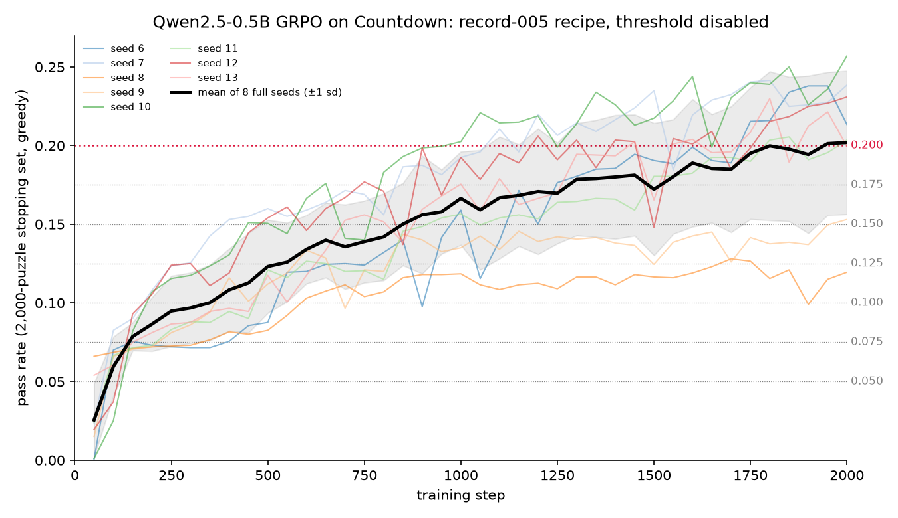
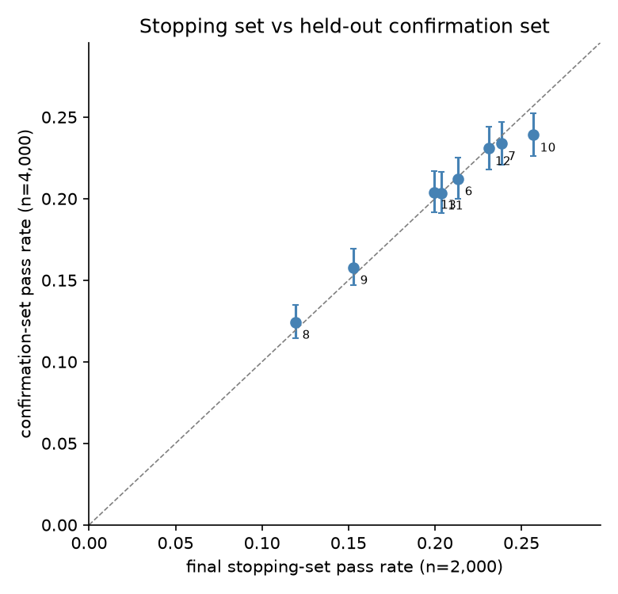
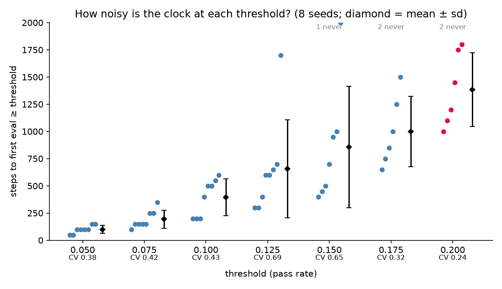
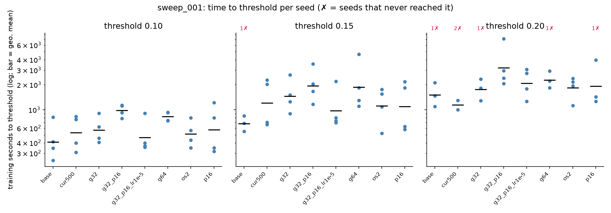

# Benchmark v2 threshold: plateau calibration and recipe sweeps

**Decision (2026-09-26): the v2 threshold is 0.20** (`benchmark.THRESHOLD`; v1 used 0.10). The
first v2 record, `006_os2_baseline_v2_h100`, is a recipe chosen because every seed reaches it.

All runs below are step-based (GPU speed does not matter), with the threshold disabled, 2,000
steps, and an eval every 50 steps on the full 2,000-puzzle stopping set. They were run on MIT ORCD
Engaging H200s with torch 2.5.1 and transformers 4.57.6. Data is in `calibration/`.

## 1. Record 005's recipe does not plateau by 2,000 steps

`calibration/plateau_005`: record 005's config with the threshold disabled, 8 seeds (6-13).
The seeds 0-3 that AWS stopped at step ~400 are in `extra/`.

* **Early jump, then a shelf.** Nearly every seed jumps to about 0.07 by step 100 (the easy gain
  from the 2- and 3-number curriculum). Most then sit on that shelf for 100-500 steps before
  climbing. At 0.10 the clock mostly timed the escape from the shelf.
* **No plateau yet.** The mean is still rising at step 2,000 (about 0.19 over steps 1,550-2,000).
  Seeds fan out widely: one levels off near 0.12, others pass 0.24. The spread is real, not
  eval noise: at p = 0.2 and n = 2,000, the Wilson 95 % half-width is about ±1.8 pp.
* **The stopping set is not overfit.** The final confirmation-set pass rate (4,000 disjoint
  puzzles) matches the stopping set to within about 1 pp for every seed.

Steps to the first eval at or above each candidate threshold (`scripts/analyze_plateau.py`):

| threshold | seeds crossed | steps mean ± sd | CV |
|--:|--:|--:|--:|
| 0.10 | 8/8 | 394 ± 170 | 0.43 |
| 0.125 | 8/8 | 656 ± 450 | 0.69 |
| 0.15 | 7/8 | 857 ± 557 | 0.65 |
| 0.20 | 6/8 | 1383 ± 339 | 0.24 |

A v2 record needs N ≥ 10 seeds that all cross, so record 005's recipe cannot carry a
threshold above about 0.125. A higher threshold needs a stronger first record.

## 2. Sweep: what gets every seed to 0.20?

`calibration/sweep_001`: 8 variants of record 005's recipe, 4 seeds each (`scripts/slurm/make_sweep.py`,
`scripts/summarize_sweep.py`). Seconds are H200 training-clock seconds, including evals, so they
only rank variants within the sweep.

| variant | reached 0.15 | reached 0.20 | s to 0.20 (CV) | s/step | final confirm |
|---|---|---|---|---|---|
| base (record 005) | 3/4 | 3/4 | 1566 (0.33) | 1.25 | 0.192 |
| cur500 (curriculum over 500 steps) | 4/4 | 2/4 | 1153 (0.18) | 1.19 | 0.203 |
| g32 (32 samples per prompt) | 4/4 | 3/4 | 1816 (0.29) | 2.05 | 0.225 |
| g64 | 4/4 | 3/4 | 2326 (0.24) | 3.65 | 0.246 |
| p16 (16 prompts per step) | 4/4 | 3/4 | 2214 (0.68) | 2.09 | 0.236 |
| g32_p16 | 4/4 | **4/4** | 3640 (0.65) | 3.63 | 0.264 |
| g32_p16_lr1e-5 | 4/4 | **4/4** | 2212 (0.38) | 3.47 | 0.263 |
| **os2** (sample 16 prompts, train on the 8 most informative) | 4/4 | **4/4** | **1901 (0.29)** | 1.68 | 0.247 |

More signal per step (bigger groups and batches, or keeping only prompts whose rollouts disagree)
raises the level runs reach and removes most stuck seeds. At 0.10 none of these variants
is faster than the base recipe, because each step costs more. `os2` got every seed to 0.20
at the lowest cost per step, so it became the baseline candidate.

`calibration/sweep_002` adds 8 seeds each to `os2` and `g32_p16`, giving N = 12. Only 3 of
the 8 new `g32_p16` seeds were run; the rest were dropped once `os2` was chosen. Variants started
and then dropped are kept in `sweep_002/extra_dropped/`.

| variant | reached 0.20 | s to 0.20 (CV) | reached 0.21 | s/step | final confirm |
|---|---|---|---|---|---|
| g32_p16 | 7/7 | 3575 (0.61) | 7/7 | 3.62 | 0.261 |
| os2 | 11/12 | 1847 (0.38) | 11/12 | 1.67 | 0.237 |

## 2b. Record 006 attempt 1: os2 stalls in about 1 run in 10

The first run of record 006 (20 seeds on Engaging H100s, stopping at 0.21 with a 3,000-step cap)
failed validation. 18 of 20 seeds crossed, and the mean confirmation pass rate was 0.201 with a
95 % CI of 0.185-0.217. The two censored seeds were:

* seed 4: policy entropy fell to about 0.002 and no groups were informative. It was stuck on the
  0.07 shelf, with a best eval of 0.097.
* seed 16: entropy stayed around 0.01, with a best eval of 0.149.

The 0.07 shelf is one specific strategy. On exactly 7.0 % of the 2,000 stopping-set puzzles, the
target is the sum of all four numbers. Seed 4's greedy completions at steps 400 and 3,000 are
the same template for every puzzle: "Add a, b, c, and d: a + b + c + d = target", followed by
`<answer>a + b + c + d</answer>`. The policy settled on "always add everything", which pays
about 7 % of the time. Once every sample in a group is that same answer, the group has no
reward variance and so gives no gradient.

Across sweep_002 and record 006, `os2` missed in 3 of 32 runs. The worst runs in every sweep are
the ones whose late-training entropy collapses (the median is about 0.03). A record needs every
one of at least 10 seeds to cross. At about 90 % per seed, that happens only about 35 % of the
time. `calibration/sweep_003` therefore tests whether a higher sampling temperature (0.9 or 1.0
instead of 0.8) removes the collapse, with 16 seeds per variant.

Six seeds also landed on `NVIDIA H100 NVL` cards (node1709). Slurm's `gpu:h100` matches both
kinds. Record workers now exclude the 2-GPU NVL nodes and check the GPU name before starting.

## 3. Record 006 stops at 0.21

The stopping rule takes the first eval at or above the target. That selects a lucky eval, so
the true pass rate at that checkpoint is lower. For `os2` at a 0.20 target, the crossing eval
reads 0.209 on average but the next three evals average 0.204. The mean confirmation pass rate
(which must be at least 0.20) would therefore be a coin flip. At a 0.21 target, the reading at the
crossing is 0.214 and the next three evals average 0.212. Record 006 therefore uses
`target_solve_rate = 0.21`. RULES.md allows this, and the extra time is on the clock.

## 4. Reference hardware and providers

The ranked GPU stays one H100 80GB SXM (`NVIDIA H100 80GB HBM3`); Engaging's H100 nodes report
exactly that. Across providers with the same software, record 005's seeds ran at 1.16-1.19 s/step
on Modal and 1.19-1.24 on RunPod. That is about 3 %, while the time to threshold varies 4× from
seed to seed. The software environment matters far more: the AWS Deep Learning AMI's torch 2.7
environment ran the same recipe about 15× slower. Records should use the pinned stack.
